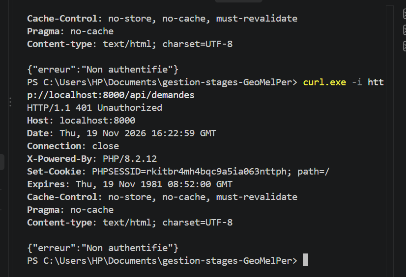
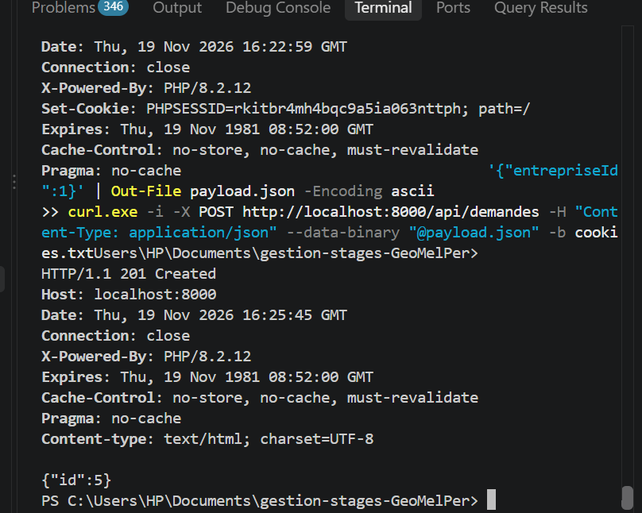
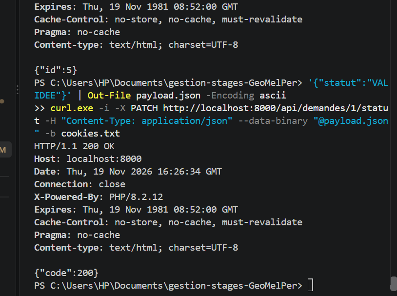
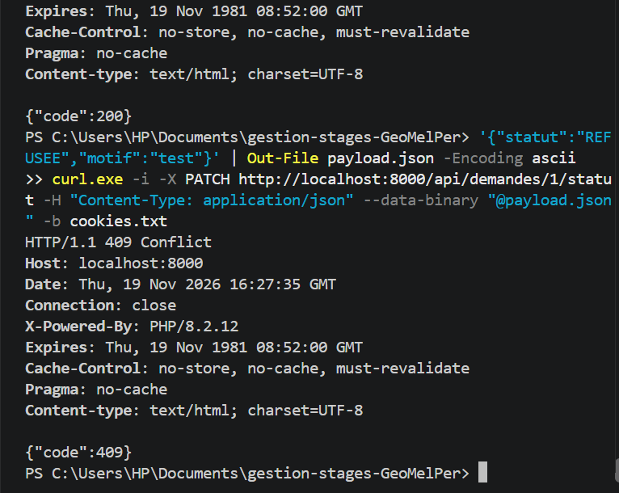
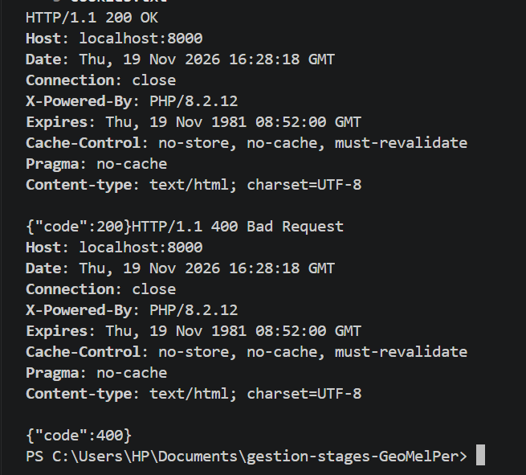
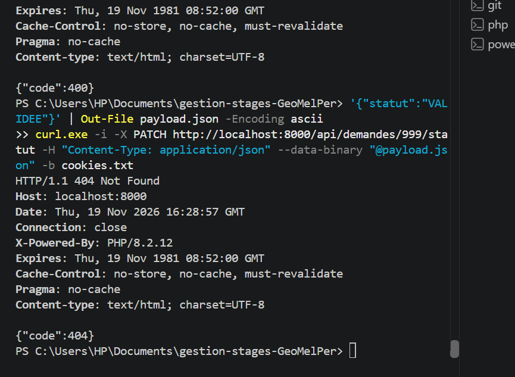

# Tests HTTP — TP6

Les preuves sont dans le dossier [captures/](captures/).

| Cas | Requête | Attendu | Observé | Preuve |
|---|---|---|---|---|
| 401 sans session | GET /api/demandes | 401 | 401 | [401.png](captures/401.png) |
| 201 création | POST /api/demandes | 201 | 201 | [201.png](captures/201.png) |
| 200 validation | PATCH /api/demandes/1/statut | 200 | 200 | [200.png](captures/200.png) |
| 409 transition interdite | PATCH /api/demandes/1/statut | 409 | 409 | [409.png](captures/409.png) |
| 400 motif manquant | PATCH /api/demandes/2/statut | 400 | 400 | [400.png](captures/400.png) |
| 404 introuvable | PATCH /api/demandes/999/statut | 404 | 404 | [404.png](captures/404.png) |

## Détail des preuves

### 401 — sans session

### 201 — création

### 200 — validation

### 409 — transition interdite

### 400 — motif manquant

### 404 — introuvable

