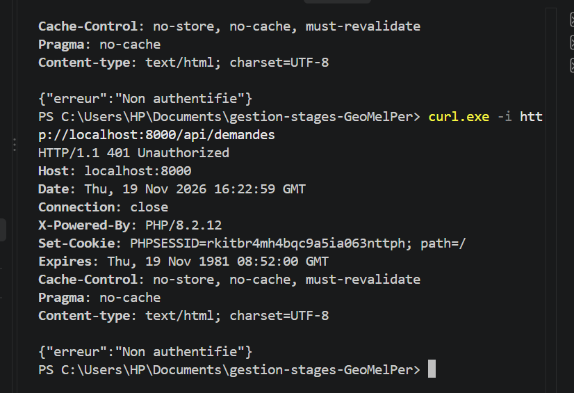
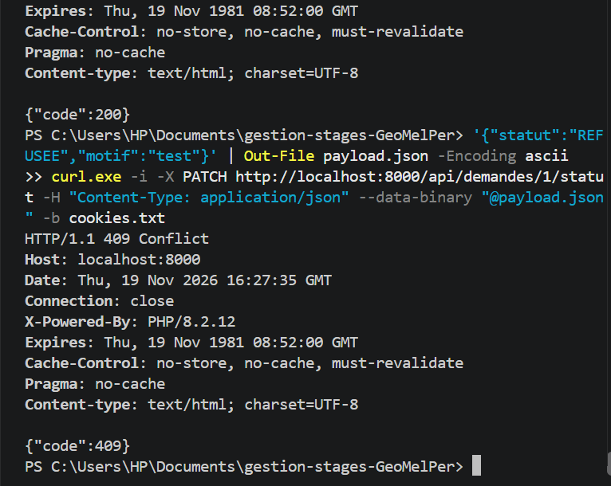
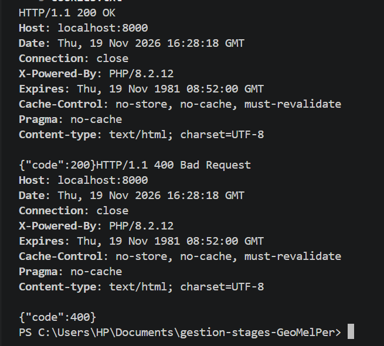
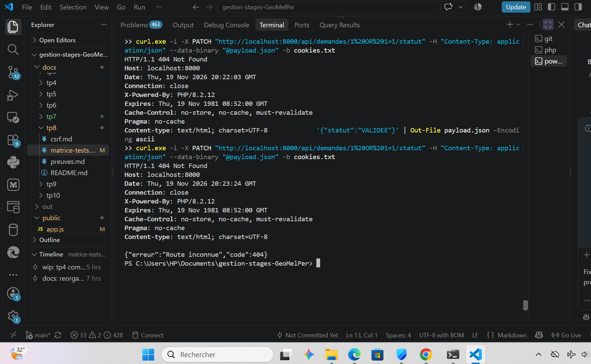

# Preuves des tests de sécurité — TP8

## 1. Autorisation (T-08 : 401 sans session)

## 2. Transition interdite (T-03 : 409)

## 3. Données invalides (T-02 : 400)

## 4. Injection SQL neutralisée (T-07)
Test via l'API : `PATCH /api/demandes/1%20OR%201=1/statut`
Résultat : l'API renvoie `404 Not Found` (la chaîne est traitée comme du texte, pas comme du code).

